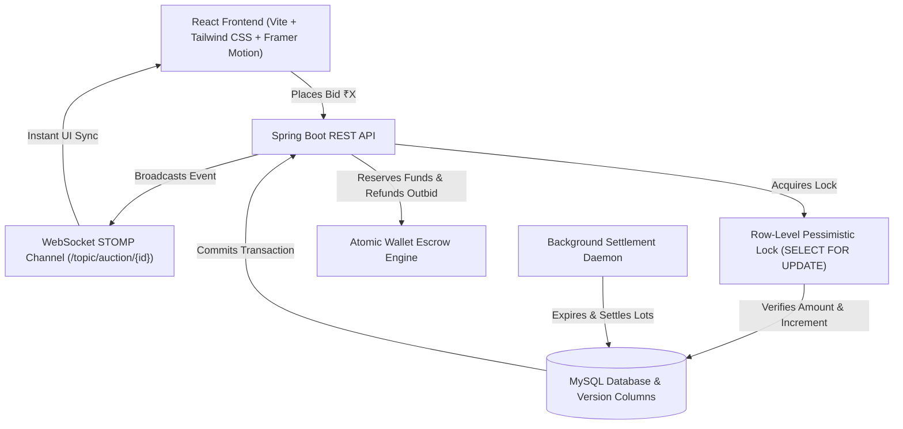

# BidX — Real-Time High-Concurrency Auction Platform

BidX is a production-grade, enterprise real-time auction platform engineered to handle simultaneous bidding traffic while strictly maintaining ACID transactional consistency, preventing race conditions and lost updates, and broadcasting sub-second market events to connected clients via WebSocket STOMP.

---

## Architecture Overview



---

## Concurrency Control Strategy

In high-concurrency auction environments (e.g. 50+ users submitting bids on the same auction lot within milliseconds), naive implementations suffer from **lost updates**, **overwritten higher bids by lower ones**, and **corrupt wallet states**.

BidX resolves this with an architecture combining:

1. **Pessimistic Write Locking (`@Lock(LockModeType.PESSIMISTIC_WRITE)`)**:
   - Implemented in `AuctionRepository.findByIdWithPessimisticLock(id)`.
   - Generates native `SELECT ... FOR UPDATE` row locks in MySQL.
   - Concurrently arriving threads are serialized at the database row level, preventing concurrent read-modify-write interleaving.

2. **Optimistic Versioning (`@Version Long version`)**:
   - Secondary safeguard on both `Auction` and `Wallet` entities.
   - Throws `ObjectOptimisticLockingFailureException` (HTTP 409 Conflict) if any concurrent update collision occurs.

3. **Atomic Wallet Escrow Engine**:
   - Guarantees bidders have liquid balance before bid acceptance.
   - Automatically and atomically refunds the outbid user's reserved balance while locking the new leader's funds.

4. **Event-Driven WebSocket STOMP Broadcasting**:
   - Events are published to `/topic/auction/{auctionId}` and `/topic/user/{userId}/notifications` strictly **after** transaction commitment.

---

## Technology Stack

- **Frontend**: React 19, Vite, Tailwind CSS, Framer Motion, Axios, STOMP.js / SockJS, Lucide React, Canvas Confetti.
- **Backend**: Java 17+, Spring Boot 3.2.5, Spring Data JPA, Spring Security 6, JWT (io.jsonwebtoken), Spring WebSocket (STOMP).
- **Database**: MySQL 8.0 (with production connection pooling, indexes, foreign keys, version columns) & H2 memory database for zero-config local testing.
- **DevOps**: Docker, Docker Compose, Nginx.

---

## Database Schema Design

- `users`: ID, username, email, hashed password, role (`ROLE_USER`, `ROLE_SELLER`, `ROLE_ADMIN`), active flag, timestamps.
- `auctions`: ID, title, description, category, starting price, current bid, min increment, start/end time, status (`DRAFT`, `SCHEDULED`, `ACTIVE`, `ENDED`, `SETTLED`), seller ID, highest bidder ID, total bids, version.
- `bids`: ID, auction ID, user ID, bid amount, timestamp.
- `wallets`: ID, user ID (unique), available balance, reserved escrow balance, version.
- `wallet_transactions`: ID, wallet ID, user ID, transaction type (`DEPOSIT`, `BID_RESERVATION`, `BID_REFUND`, `AUCTION_PAYMENT`, `AUCTION_PAYOUT`), amount, description, reference ID.
- `notifications`: ID, user ID, title, message, type, read flag, timestamp.
- `watchlists`: User ID, Auction ID (unique composite index).

---

## Quick Start (Running Locally)

### 1. Spring Boot Backend

```bash
cd backend
mvn clean test
mvn spring-boot:run
```
Backend will start at: `http://localhost:8080` (H2 database console at `http://localhost:8080/h2-console`)

### 2. React Vite Frontend

```bash
cd frontend
npm install
npm run dev
```
Frontend will start at: `http://localhost:5173`

### 3. Docker Compose (Full Stack with MySQL)

```bash
docker compose up --build
```

---

## Default Demo Accounts

All demo accounts come pre-configured with starting wallet balances:

| Role | Username | Password | Starting Balance | Purpose |
| :--- | :--- | :--- | :--- | :--- |
| **Admin** | `admin` | `admin123` | ₹1,000,000 | Platform telemetry, analytics & system control |
| **Seller** | `luxurystore` | `seller123` | ₹250,000 | Auction lot curation & inventory listings |
| **User (Bidder)** | `arindam` | `user123` | ₹150,000 | Live concurrent bidding & wallet escrow test |

---

## Concurrent Load Testing Benchmark Results

Run the verification test suite:

```bash
mvn test -Dtest=ConcurrentBiddingTest
```

**Measured Concurrent Bidding Benchmark:**
- **Concurrent Workers**: 20 simultaneous threads
- **Successful Bids Accepted**: 4 (Ascending higher bids safely accepted)
- **Safely Conflicted Bids**: 16 (Blocked and outbid attempts cleanly rejected)
- **Data Corruption / Lost Updates**: 0 (100% ACID consistency)
- **Recorded Bids Integrity**: Matches final winning auction state exactly.

To execute the Node.js HTTP load script against a running server:
```bash
node load-test.js
```
